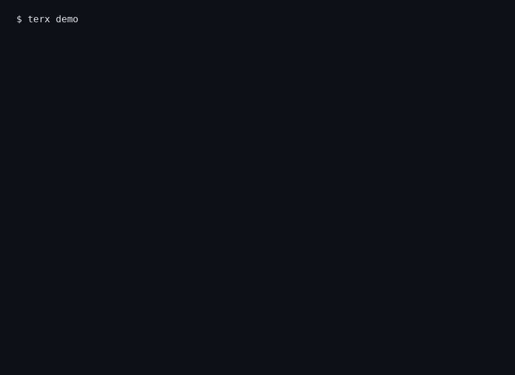

# TERX

[](https://pypi.org/project/terx/)
[](https://github.com/ixchio/terx/actions/workflows/tests.yml)
[](https://pypi.org/project/terx/)
[](https://github.com/ixchio/terx/blob/main/LICENSE)
[](https://m8ven.ai/mcp/ixchio-terx-izqucs?s=readme)

**Your browser agent already did this task once. Replay it without the
model, and only when it is safe to.**

TERX records what a browser agent did as a few plain actions, such as "type
into Email" and "click Sign in". The next time the same task comes up, TERX
replays those actions directly in Chrome with no model call. Before it acts it
checks the page and the account scope, and afterwards it checks the result. If
something does not match, it refuses and hands control back to your agent
instead of guessing.



## Try it in 60 seconds

```bash
pip install terx
terx demo
```

You need Chrome, Chromium, or Edge installed. The demo starts its own
throwaway headless browser and a page served from your machine. It needs no
API key and no account, and nothing leaves your computer.

## What you just saw

1. **Record.** A stand-in for your agent signed in. TERX saved three actions,
   but only after checking the page showed the expected result. The password
   was saved as `{{password}}`, never its value.
2. **Replay.** The same task ran for a different account. No agent and no
   model were involved, and TERX checked the result again.
3. **Refuse.** The page changed so that two fields were both called "Email".
   TERX could not tell which one was meant, so it stopped before typing
   anything.

Every "✓" in the demo is checked against the real page or TERX's real files
while it runs.

## Use it with your agent

**From an MCP client (Cursor, Claude Desktop, Windsurf, Codex).** TERX ships
an MCP server that gives your agent a browser, plus recording and replay.

1. Start Chrome with remote debugging:

   ```bash
   google-chrome --remote-debugging-port=9222 --no-first-run \
     --user-data-dir=/tmp/terx-chrome
   ```

2. Add the server to your client. This prints the snippet to paste:

   ```bash
   terx mcp-config --client cursor
   ```

3. Your agent wraps a repeatable task in `browser_task_start` and
   `browser_task_finish`. The first run is recorded. Later runs of the same
   task replay without the model. See [MCP](#mcp) for the full contract.

**From Python.** If your code already drives Chrome over CDP, wrap a task with
`TerxWorkflow`: see the [application adapter](#lightweight-application-adapter).

## Is TERX right for you?

**A good fit when:**

- your agent repeats the same browser task (sign in, look up an order, file a
  form) and pays for a model to work it out again every time;
- a recorded task must only run for the right account, on the page it was
  recorded on, and must stop when the page has changed;
- destructive steps need an approval that can be used only once.

**Not a fit when:**

- the task is one-off exploration, so there is nothing to replay;
- your agent drives the browser through Playwright or its own CDP connection.
  Today TERX records only actions sent through its MCP tools or its Python
  adapter;
- the task needs file uploads, drag and drop, multiple tabs, or iframes from
  another site. TERX will not record those yet;
- you want a general automation framework or a hosted browser fleet. Use
  Playwright, Stagehand, or Browser Use for that. TERX is the layer that
  decides whether a known-good task may be reused.

## How replay stays safe

Every cacheable workflow must declare:

- a `scope_id` that binds it to a tenant, account, environment, or fixture;
- a `precondition` checked before replay;
- a `postcondition` checked after the first run and every replay;
- a route, workflow version, TTL, and side-effect class.

Conditions support `url_contains`, `title_contains`, `text_contains`, and
`selector_exists`; every value must be a non-empty string. Their full values participate in a policy fingerprint but
are not written to the cache. Change any part of a workflow contract and bump
`workflow_version` to intentionally create a new replay entry.

TERX persists only six semantic actions:

- `TERX.navigate` — an `http` or `https` origin-and-path navigation (no query,
  fragment, or embedded credential). The path may hold `{{variable}}`
  placeholders, and a path segment equal to a variable's value is recorded as
  one, so `/orders/A-100` replays as `/orders/<new order_id>`;
- `TERX.click` — one element identified by accessible role and label;
- `TERX.type` — replace a labelled input's value with a named variable;
- `TERX.check` — set a checkbox, switch, or radio to on or off (never toggle);
- `TERX.select` — choose a dropdown option by its visible label or a variable;
- `TERX.press` — press `Enter`, `Tab`, or `Escape` on a labelled element.

Each target records its role and label, plus its position among same-role
elements, its iframe, and a `data-testid`-style attribute when present. A
target must not be ambiguous, and its signals must agree: if the label now
belongs to an element with a different test id, TERX refuses. A changed label
is tolerated only when the test id *and* the position still identify one
element, and the replay report lists every such drift in `locator_notes`.

Raw CDP commands, coordinate clicks, other key events, and arbitrary
JavaScript still run on the cold path but make the workflow non-cacheable.
Ambiguous targets, failed conditions, missing variables, expiry, and unapproved
destructive work produce a structured refusal; TERX does not silently invoke an
LLM.

## Why it stays lightweight

TERX reuses the Chrome CDP connection your application already owns. Its core
runtime is an async CDP bridge, an accessibility-tree snapshot, and local
SQLite—no Playwright or Selenium runtime, browser fleet, background service,
or cloud account. The workflow adapter holds an accessibility snapshot only
while a cold path is running and discards it before the next workflow.

## Python quickstart

Start Chrome with remote debugging as shown [above](#use-it-with-your-agent),
then:

```python
from terx import BrowserSession, MemoryCache, session_for

cache = MemoryCache()

async with BrowserSession() as session:
    bridge = session.bridge()
    async with session_for(
        cache,
        bridge,
        "sign in to the billing dashboard",
        scope_id="acme-prod:billing-service-account",
        route_pattern="/login",
        workflow_version=1,
        side_effect="mutating",
        variables={"email": "bot@acme.test", "password": "from-secret-store"},
        precondition={"url_contains": "/login"},
        postcondition={"text_contains": "Billing overview"},
    ) as replay:
        if replay.hit:
            await replay.replay()
        else:
            # Drive bridge.send(...) from your agent here. Only labelled clicks
            # and named-variable text entry become replayable actions.
            await your_agent.run()

    print(replay.report.as_dict())
```

For a destructive workflow, require a host approval verifier that atomically
checks and consumes a fresh approval for this exact replay identity:

```python
from terx import ApprovalDecision

async def verify_and_consume(request):
    verdict = await control_plane.consume_browser_approval(
        token=request.token,
        scope_hash=request.scope_hash,
        task=request.task_description,
        workflow_version=request.workflow_version,
        policy_fingerprint=request.policy_fingerprint,
        structural_hash=request.structural_hash,
        command_digest=request.command_digest,
    )
    return ApprovalDecision(verdict.approved, verdict.consumed, verdict.reason)

# Pass approval_verifier=verify_and_consume when creating session_for(...).
await replay.replay(approval_token=approval_from_your_control_plane)
```

Without both a token and a verifier result with `approved=True` and
`consumed=True`, TERX refuses before running any replay action. The standalone
`terx-server` has no verifier by default and therefore fails closed for
destructive cache hits.

`ReplayReport.status` is one of `miss`, `hit`, `refused`, or `failed`. Treat a
refusal as a signal to run an approved cold-path agent flow or ask for input;
do not assume TERX completed the task.

## MCP

```bash
terx-server
```

```json
{
  "mcpServers": {
    "terx": { "command": "terx-server" }
  }
}
```

Start a cacheable task with a complete contract, run normal `browser_*` tools
on a miss, then finish it:

```text
browser_task_start(
  task="sign in to billing",
  scope_id="acme-prod:billing-service-account",
  precondition={"url_contains": "/login"},
  postcondition={"text_contains": "Billing overview"},
  variables={"email": "bot@acme.test", "password": "..."}
)
browser_task_finish(success=true)
```

For `side_effect="destructive"`, `replay_approval` is only an opaque token.
The application embedding `TERXServer` must configure a consume-once
`approval_verifier`; the standalone server refuses destructive cache hits by
default. The MCP server returns a refusal reason when it declines to act.

Print the local configuration for a client; this command only writes to stdout
and does not install a daemon or change client settings:

```bash
terx mcp-config --client cursor
terx mcp-config --client codex
```

## Lightweight application adapter

For code that already has a Chrome CDP bridge, use TERX's dependency-free
workflow adapter. It adds no Playwright/Selenium runtime, browser process, or
background worker. The cold path exposes only the actions TERX can prove and
replay: `navigate`, `click`, `type_into`, `set_checked`, `select_option`,
`press`, and the non-recorded `wait_for`. Each element action takes an optional
`frame=` for an element inside a same-origin iframe:

```python
from terx.integrations.workflow import TerxWorkflow

workflow = TerxWorkflow(
    cache=cache,
    bridge=bridge,
    task="sign in to billing",
    scope_id="acme-prod:billing-service-account",
    variables={"email": "bot@acme.test", "password": "from-secret-store"},
    precondition={"url_contains": "/login"},
    postcondition={"text_contains": "Billing overview"},
)

async def sign_in(browser):
    await browser.type_into("textbox", "Email", "email")
    await browser.type_into("textbox", "Password", "password")
    await browser.click("button", "Sign in")
    await browser.wait_for({"text_contains": "Billing overview"})

result = await workflow.run(sign_in)
```

On a warm hit, `sign_in` is never called. Direct mutating bridge calls are
intentionally excluded: use the adapter's semantic actions or TERX refuses to
call it a replayable workflow. See [integration guidance](https://github.com/ixchio/terx/blob/main/docs/integrations.md).

## Save a task as a tool

The MCP server can persist a reviewed workflow as a named, discoverable tool.
The manifest contains the task contract, input names, result schema, and a
scope digest—never input values or the raw scope. On a call, TERX verifies the
caller scope, replays only a matching approved workflow, then reads a small
declared set of **current** page fields. A miss, drift, changed scope, or
missing result field is a refusal; it never launches a hidden cold agent.

```text
# Agent A records a supported workflow, then promotes it.
browser_task_start(...)
browser_type(...)
browser_click(...)
browser_task_finish(success=true)
browser_tool_save(
  name="check_order_status",
  input_names=["order_id"],
  result_spec={
    "order_id": {"source": "input", "name": "order_id"},
    "status": {"source": "text", "selector": "[data-order-status]"}
  },
  ...the reviewed scope and replay policy...
)

# Any MCP client using that TERX server/cache can discover and call it later.
browser_tool_list()
browser_tool_run(name="check_order_status", inputs={"order_id": "A-101"}, scope_id="...")
```

Result fields are intentionally narrow: visible text from a CSS selector, page
title, page URL, or an echoed non-sensitive input. TERX does not save arbitrary
JavaScript or form values as a tool result.

Run the complete local `check_order_status(account_id, order_id)` example:

```bash
python3 examples/saved_tool_order_status.py
```

[Watch the reproducible 20-second demo](https://github.com/ixchio/terx/blob/main/docs/assets/terx-v0.5-saved-tool-demo.mp4).
It records the approved local lookup, saves its contract, reconnects Chrome, and
returns a fresh status for a different account and order ID. The video shows
**zero TERX model calls during replay**; it does not claim the caller or browser
is free.

## Security model

- The cache is local SQLite under `.terx/`; protect that directory as
  application data.
- Named typed values are stored as `{{placeholders}}`; typed text without a
  named variable is intentionally not cacheable.
- A saved tool stores only its input names and scope digest. Its live result is
  returned to the current caller and is not written into the replay cache.
- Password, token, key, and similar named fields are redacted at cache and
  audit boundaries. Cached response payloads are not retained, and TERX never
  captures screenshots.
- Scope IDs are stored as a keyed HMAC digest (key in `.terx/scope.key`), so a
  listed digest cannot be reversed by guessing. A scope is a namespace the
  caller asserts, not an authentication credential.
- MCP clients can replace or delete a saved tool, or invalidate cached
  workflows, only for a scope they present; a tool can be saved only for a
  live recorded workflow.
- TERX contains no model client: neither recording nor replay calls an LLM.

See [SECURITY.md](https://github.com/ixchio/terx/blob/main/SECURITY.md) for the
full boundary and reporting policy.

## Supported integration surface

Python, the dependency-free workflow adapter, saved MCP tools, and the built-in
MCP server are supported in 1.0, under the [versioning policy](https://github.com/ixchio/terx/blob/main/docs/versioning.md). The
Browser Use adapter is experimental: it can only record
agents that intentionally drive the TERX CDP bridge supplied to it. A normal
Browser Use session is not a drop-in capture source.

## Verification

```bash
pytest tests/ -v
ruff check .
mypy
terx eval-local
terx eval-hard --gate
```

`terx eval-local` launches a temporary local page and headless Chrome to verify
cold recording and warm semantic replay. `terx eval-hard` replays 15 harder
scenarios (page loads after submit, late rendering, controlled inputs, shadow
DOM, iframes, translated labels, checkboxes, dropdowns, Enter to submit, URL
variables, and five pages that must be refused) and checks the real page
outcome. It reports the **replay rate**, the **false refusal rate**, and
**unsafe outcomes**; `--gate`, which CI runs, fails on any unsafe outcome or
false refusal. See [benchmarks](https://github.com/ixchio/terx/blob/main/docs/benchmarks.md) for current numbers.
Neither suite establishes compatibility with arbitrary production websites.

## Development

```bash
git clone https://github.com/ixchio/terx.git
cd terx
pip install -e ".[dev]"
pytest tests/ -v
ruff format --check .
ruff check .
python -m terx.evals.local_suite
```

See the [quickstart](https://github.com/ixchio/terx/blob/main/docs/quickstart.md),
[development guide](https://github.com/ixchio/terx/blob/main/docs/development.md),
and [changelog](https://github.com/ixchio/terx/blob/main/docs/changelog.md).
